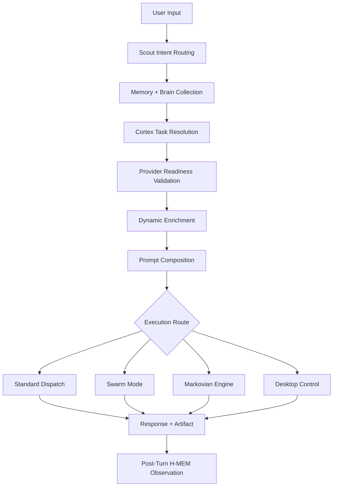

<div align="center">

<!-- Replace this with your product hero image or demo GIF -->


<br />

# Meterless Gaia

### The local-first cognitive OS that can see, remember, reason, and act across your computer.

<p>
  <strong>Most AI tools generate answers. Gaia executes reality.</strong>
</p>

<p>
  <a href="#quickstart"></a>
  <a href="#architecture"></a>
  <a href="#local-first-runtime"></a>
  <a href="#license"></a>
</p>

</div>

---

## What Gaia Is

**Meterless Gaia** is a desktop-native cognitive operating system built for the place where real work actually happens: across apps, browsers, windows, files, tabs, tools, and long-running tasks.

It is not a chatbot with a few tools attached.

Gaia combines:

- **Native desktop control**
- **Screen and browser perception**
- **Long-horizon reasoning**
- **H-MEM persistent memory**
- **12-brain cognitive orchestration**
- **Shared WorldState**
- **Local-first model execution**
- **Universal artifact surfaces**

The result is an AI system that can move from instruction to execution without handing the work back to you.

---

## The Shift

Most AI products still stop too early.

```text
Ask → Answer → Copy → Switch Apps → Do the Work Yourself
```

Gaia changes the loop.

```text
Ask → Ground → Reason → Act → Observe → Adapt → Complete
```

Give Gaia a real instruction, and it can open apps, browse, read what is on screen, click, type, scroll, use tools, remember context, and continue through multi-step work.

---

## The Moment It Clicks

```text
"Research how to use Google AI Studio and build a particle simulation."
```

Gaia can:

1. Open the browser through a native control session
2. Ground itself with live browser capture and search
3. Navigate to AI Studio
4. Write the right prompt
5. Generate the simulation
6. Return the result as an artifact

That is the difference between an assistant that tells you what to do and an operating system that can actually do it.

---

## Core Capabilities

| Capability | What it does | Why it matters |
|---|---|---|
| **Desktop Control** | Clicks, types, scrolls, focuses, and navigates real apps | Gaia can operate in the same environment you do |
| **Observer + Vision** | Reads live screen and browser state | Reasoning is grounded in what is actually visible |
| **Markovian Thinking** | Compresses state across long tasks | Long workflows do not collapse under context growth |
| **Project Eywa** | 12 specialized brains across 4 cognitive layers | Gaia behaves like a system, not one frozen prompt |
| **Shared WorldState** | Keeps tools, brains, artifacts, and windows synchronized | Planning and execution stop drifting apart |
| **H-MEM** | Preserves context, preferences, constraints, and memories | The system does not restart from zero every session |
| **Dynamic Enrichment** | Injects browser capture, search, and live context | Actions are tied to evidence, not guesses |
| **Universal Viewer** | Opens generated artifacts as durable interfaces | Outputs become usable surfaces, not disposable text |
| **Universal @Mentions** | Pulls files, memories, brains, windows, tools, and modes into a turn | You can steer context and execution precisely |
| **Local-First Runtime** | Supports WebLLM, Ollama, and embedded GGUF paths | Sensitive workflows can stay on your machine |

---

## How Gaia Works



Under the hood, Gaia routes work through services such as:

```text
brainPreprocessor
brainInjectionService
dynamicEnrichmentService
promptComposerService
modelOrchestrator
desktopAutomationService
post-turn H-MEM observation
```

This is not one model call with a fancy skin. It is a routed operating system.

---

## Project Eywa: The 12-Brain Cognitive Stack

Gaia’s cognitive system is organized across four layers:

| Layer | Purpose |
|---|---|
| **Perception** | Observe the environment, screen, browser, artifacts, and signals |
| **Intelligence** | Interpret patterns, classify intent, reason, and plan |
| **Autonomy** | Shape goals, recover from drift, coordinate long tasks |
| **Execution** | Generate artifacts, take actions, write outputs, and complete work |

Brains such as **Scout, Sentinel, Oracle, Weaver, Commander, Healer, Miner, Forge, Runtime, and Scribe** coordinate through ORAE loops:

```text
Observe → Reason → Act → Evaluate
```

---

## Local-First Runtime

Gaia is designed for workflows where privacy and control matter.

Supported local and edge paths include:

- **WebLLM** for browser/WebView inference
- **Ollama** for desktop-local providers
- **Embedded GGUF sidecar runtime**
- **Local vision paths** with Transformers.js and ONNX
- **Tauri desktop command surfaces**

Cloud providers can still be used when you want them, but Gaia is not architected around forced cloud dependency.

---

## Use Cases

### Cross-App Workflow Automation

Research a topic in the browser, update a spreadsheet, draft an email, and save the result without manually switching between tools.

### Learn a Tool, Then Use It

Ask Gaia to research how a product works, then operate that product on your behalf.

### AI Tool Orchestration

Use other AI systems as tools: ask Gaia to prompt external AI products, retrieve outputs, and combine them into one workspace.

### Multi-Day Knowledge Work

Carry context across research, architecture reviews, due diligence, writing, and strategic analysis without starting from zero every day.

### Sensitive Local Workflows

Analyze proprietary code, legal documents, financial models, or HR data with local inference paths where possible.

---

## Architecture

| Layer | Stack |
|---|---|
| Frontend | React 19, TypeScript, Vite |
| Desktop Shell | Tauri 2 + Rust |
| Embedded Runtime | Axum, Tokio, llama-cpp-compatible GGUF sidecar |
| Persistence | IndexedDB, Tauri JSON storage, workspace files |
| Providers | Google, Anthropic, OpenAI, Groq, Mistral, WebLLM, Ollama, embedded GGUF |
| Shared Services | Brains, H-MEM, context registry, enrichment, prompt composition, missions, workspace services, desktop automation |

---

## Quickstart

```bash
git clone https://github.com/meterless-ai/meterless-gaia.git
cd meterless-gaia
npm install
npm run tauri:dev
```

### Requirements

- Node 18+
- Rust 1.77+
- Tauri toolchain
- Desktop mode for native execution features

Browser mode can support UI iteration, but the full Gaia experience runs through the desktop shell.

---

## Suggested Screenshots

Add these to your repo under `/assets`:

```text
assets/gaia-hero.png
assets/gaia-worldstate.png
assets/gaia-desktop-control.gif
assets/gaia-universal-viewer.png
assets/gaia-memory.png
```

Then replace the hero image at the top of this README.

---

## How Gaia Fits With Meterless

```text
Gaia decides what to do.
Swarms thinks in parallel.
Relay executes in reality.
```

Use **Gaia** when you want the higher-level cognitive operating system.

Use **Swarms** when you want parallel multi-agent thinking, generation, merge, and verification.

Use **Relay** when you need grounded desktop execution that survives real-world UI drift.

---

## FAQ

### Is Gaia just a chatbot with desktop tools?

No. Gaia is built around shared WorldState, routed cognition, 12-brain orchestration, H-MEM, Markovian long-horizon reasoning, native desktop control, and artifact surfaces.

### Can it actually control desktop apps?

Yes. In Tauri desktop mode, Gaia uses session-based desktop control and typed actions such as focus, click, type, keys, scroll, move, and bounds.

### What keeps Gaia from losing track on long tasks?

The Markovian engine carries compressed state forward instead of blindly growing the prompt forever. Silent Observer helps detect semantic drift while work is underway.

### Does Gaia work offline?

Parts of Gaia can run locally through WebLLM, Ollama, local vision, and embedded GGUF runtime paths. Cloud features are optional depending on provider configuration and task needs.

---

## The Takeaway

Most AI tools answer.

**Gaia can answer, see, remember, route, ground itself, and act.**

It turns the assistant from something you talk to into something that can operate in the same reality you do.

---

## License

See [`LICENSE.md`](LICENSE.md).
