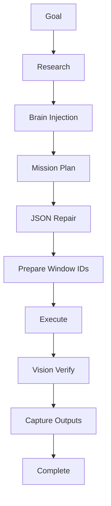
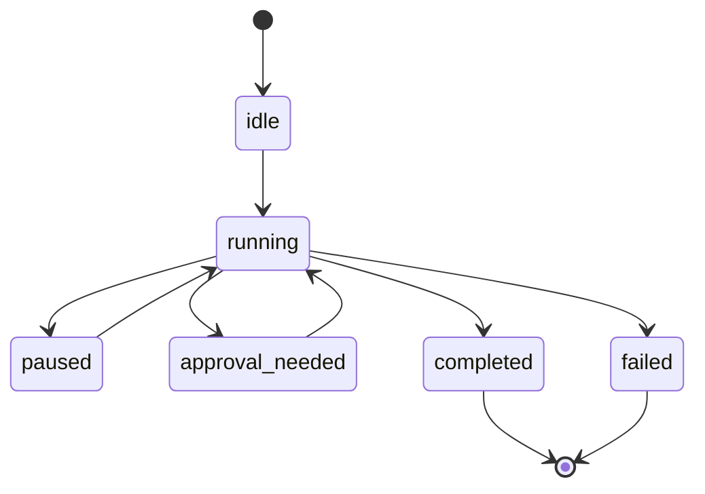

<div align="center">


<br />

# Meterless Relay

### Natural-language desktop automation for real OS windows.

<p>
  <strong>Turn instructions into real desktop workflows.</strong>
</p>

<p>
  <a href="#quickstart"></a>
  <a href="#tracked-windows"></a>
  <a href="#vision-verification"></a>
  <a href="#license"></a>
</p>

</div>

---

## What Relay Is

**Meterless Relay** is a Tauri + Rust desktop automation engine that takes a natural-language goal, compiles it into a schema-validated mission plan, executes that plan across real desktop windows, verifies critical steps with vision, and saves outputs as reusable artifacts.

Relay is built for the part of automation most tools still fail at:

**the messy, shifting reality of the actual desktop.**

---

## The Problem

Most desktop automation breaks for boring reasons.

- Windows get matched by fuzzy titles
- Focus changes
- Z-order changes
- Handles drift after app restarts
- Tiny UI changes cause silent failures
- Scripts assume the world has not moved

That is why so much automation feels impressive in a demo and fragile in real work.

Relay fixes the root problem by grounding automation in the real desktop state before it acts.

---

## The Relay Loop

```text
Describe the goal
→ Inspect the plan
→ Run with grounded execution
→ Verify critical steps
→ Capture reusable outputs
```

This is not “AI trying stuff.”

It is a desktop workflow engine that knows what machine it is operating on.

---

## The Moment It Clicks

```text
"Log into my trading platform, check positions, and export today’s report."
```

Relay does not jump straight into blind clicking.

It can:

1. Research the goal when appropriate
2. Build a live desktop context snapshot
3. Compile a structured `MultiWindowMissionPlan`
4. Let you inspect the plan
5. Resolve tracked windows by stable IDs
6. Execute through native Windows APIs
7. Verify critical screens with vision
8. Save outputs into a workspace artifact store

---

## Core Capabilities

| Capability | What it does | Why it matters |
|---|---|---|
| **Tracked Windows** | Uses stable window IDs across up to 8 tracked sessions | Automation stays grounded in real desktop identity |
| **Mission Compiler** | Turns goals into `MultiWindowMissionPlan` JSON | Workflows are structured before execution |
| **Brain Injection** | Injects desktop state, Z-order, tools, and procedural memory | Plans reflect the live machine, not a guess |
| **JSON Repair Pipeline** | Repairs malformed model output before execution | One bad JSON response does not kill the mission |
| **Self-Healing Run Prep** | Refreshes and remaps window IDs before execution | Missions survive app restarts and drift |
| **Native Win32 Execution** | Focuses, clicks, types, scrolls, and navigates through Rust + Windows APIs | Actions are more reliable than browser-layer hacks |
| **Vision Verification** | Compares expected screen state to actual screen state | Critical steps can be checked before continuing |
| **Approval Gates** | Pauses for human sign-off on sensitive work | Users stay in control when stakes are high |
| **Procedural Memory** | Recalls repeatable habits by app and task type | Daily workflows become faster to rerun |
| **Workspace Artifacts** | Saves extracted outputs from completed phases | Results persist instead of disappearing |

---

## How Relay Works



Key services include:

```text
missionPlanCompiler
brainInjectionService
desktopStateInjector
parseLlmJson
preparePlanWindowIdsForExecution
desktopAutomationService
screenVerificationService
outputCaptureService
```

Relay is not one giant black box. You can point to the pipeline.

---

## Tracked Windows

Relay does not treat windows as fuzzy strings.

It uses a **Tracked Windows** model where up to 8 concurrent native OS windows are managed as first-class `ControlSession` entries. Each has a durable window ID that the planner, workflow engine, brain injection pipeline, and vision verification system all reference as shared ground truth.

Screen-capture surfaces like `win_*` can mirror real native OS handles like `native_*`, so preview video, real input injection, and vision checks all resolve to the same underlying window.

That is the difference between hoping title matching still works tomorrow and building automation on a stable desktop substrate.

---

## Vision Verification

Relay does not assume the click worked.

It can capture PNG frames from tracked sessions and route them through a vision model for structured expected-vs-actual checks.

This enables:

- Critical screen validation
- Visual extraction
- Auditable phase captures
- Safer high-stakes workflows
- Better recovery when UI state drifts

---

## Self-Healing Execution

Automations break when a plan was compiled before a window moved, closed, reopened, or changed identity.

Relay prepares plans before execution by:

- Refreshing live native windows
- Remapping stale window IDs
- Collapsing IDs when one session is tracked
- Upgrading input steps to prefer `native_*` handles
- Resolving current desktop reality before taking action

A mission compiled yesterday has a real chance of running cleanly today.

---

## Architecture

| Layer | Stack |
|---|---|
| Shell | Tauri 2 + Rust |
| UI | React 19, TypeScript, Tailwind, Vite |
| Planner Path | `missionPlanCompiler → brainInjectionService → llmService` |
| Execution Path | `workflowEngine → desktopAutomationService → Tauri IPC → Rust` |
| Verification Path | `screenVerificationService → outputCaptureService` |
| Persistence | Tauri Store, localStorage compatibility |
| Native Layer | Windows APIs, `windows`, `sysinfo`, `enigo` |
| Plugins | `tauri-plugin-shell`, `tauri-plugin-store` |

---

## Workflow State Machine



Steps can carry failure policies such as:

- `continue`
- `retry`
- `halt`
- `approval_needed`

---

## Example Workflows

### Daily Reporting

Open a desktop platform, collect the day’s output, export the report, and save the extracted result as a workspace artifact.

### Procedure Replay

Perform a routine once, let Relay accumulate the habit in procedural memory, then rerun similar tasks without restating the full sequence.

### High-Stakes Approvals

Compile a mission that reaches a sensitive action, pause for approval, inspect the plan and screen, then sign off before continuing.

### Multi-Window Desktop Work

Track several native windows and run a workflow across them without relying on fragile title matching.

---

## Quickstart

### Desktop (Windows)

Grab the latest installer from the releases page, either the `.msi` or the NSIS `.exe`, and install. The app launches on its own and stores local app data under `%APPDATA%\MeterlessGaia`.

### Local dev

```bash
git clone https://github.com/meterless-ai/meterless-gaia.git
cd meterless-gaia
npm install
npm run dev
```

To run the Tauri desktop app locally:

```bash
npm run tauri:dev
```

To build the Tauri installers locally:

```bash
npm run tauri:build
```

To build just the web bundle:

```bash
npm run build
```

### Requirements

- Node 18+
- Rust
- Tauri toolchain
- Windows for native automation

Relay’s native automation layer is Windows-first. Browser-only development is useful for UI iteration, but native window listing and IPC-driven automation require Tauri desktop mode.

---

## Suggested Screenshots

Add these to your repo under `/assets`:

```text
assets/relay-hero.png
assets/relay-tracked-windows.png
assets/relay-mission-plan.png
assets/relay-vision-verification.gif
assets/relay-artifacts.png
```

Then replace the hero image at the top of this README.

---

## How Relay Fits With Meterless

```text
Gaia decides what to do.
Swarms thinks in parallel.
Relay executes in reality.
```

Use **Relay** when you need reliable real-world execution.

Use **Gaia** when you want broader autonomous intelligence and exploration.

Use **Swarms** when you need parallel planning, generation, merge, and verification.

---

## FAQ

### Is Relay just macro recording with AI on top?

No. Relay is a workflow compiler and executor. Recording and replay can be part of the system, but the core architecture is goal, research, brain injection, schema-validated planning, self-healed execution, visual verification, and artifact capture.

### Does Relay depend on fuzzy window title matching?

No. Relay is built around tracked window IDs and mirrored native/capture session linking.

### What happens if the model returns broken JSON?

Relay runs planner output through a repair pipeline that strips fences, repairs malformed JSON, normalizes IDs, and fills defaults.

### Can it verify what happened on screen?

Yes. Relay can capture PNG frames from tracked sessions and route them through a vision model for expected-vs-actual checks and structured extraction.

---

## The Takeaway

Desktop automation used to mean:

```text
Write scripts and hope they do not break.
```

Meterless Relay changes the model:

```text
Describe the goal.
Inspect the plan.
Run with grounded execution and verification.
Reuse what works.
```

Relay is window-aware, state-aware, repair-tolerant, vision-verified, and reusable the moment a workflow succeeds.

---

## License

See [`LICENSE.md`](LICENSE.md).
