<div align="center">

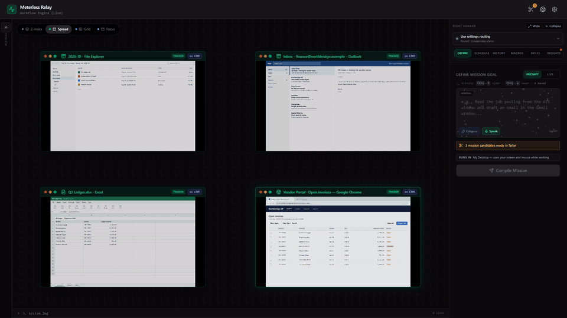

<br />

# Meterless Relay

### Describe the job. Watch it get done.

<p>
  <strong>Type one sentence. Relay plans it across the Windows apps you already use, checks every step, and waits for you before anything you can't take back.</strong>
</p>

<p>
  <a href="https://meterless.ai/Installers/meterless-relay-latest.exe"></a>
  <a href="CHANGELOG.md"></a>
  <a href="#every-step-gets-a-verdict"></a>
  <a href="#give-your-coding-agent-hands"></a>
  <a href="LICENSE"></a>
</p>

<p><a href="https://meterless.ai/relay.html"><b>meterless.ai/relay</b></a> · <a href="docs/getting-started.md">Getting started</a> · <a href="docs/features.md">Features</a> · <a href="docs/agent-bridge.md">Agent bridge</a> · <a href="docs/faq.md">FAQ</a> · <a href="CHANGELOG.md">Changelog</a></p>

</div>

---

## What Relay does

You write what you want done, the way you'd say it to a coworker. Relay reads the windows you have open, writes a plan you can read and edit, then drives the real apps with native clicks and keystrokes. It checks each step as it goes, pauses at anything consequential like sending an email, and saves what you approve so the next run of the same job needs no model calls at all.

It's a free Windows app. The installer is 3.3 MB. You bring your own model, or run a small one locally.

```text
Describe  →  Plan  →  Run  →  Verify  →  Approve  →  Remember
```

---

## One sentence, five windows

Here is a real Relay run, start to finish. The job:

> *"Every weekday at 4:30, export open invoices from the vendor portal, reconcile them against the Q3 ledger, and draft a summary email to Finance. Halt before sending."*

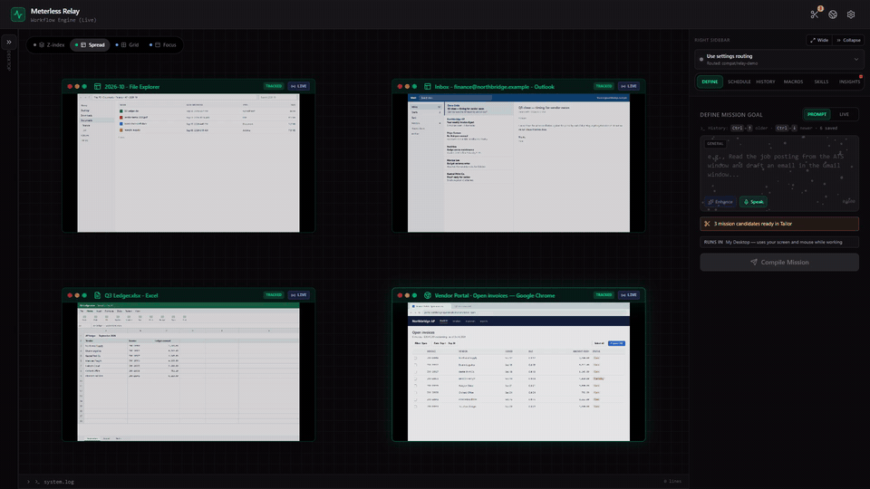

<table>
  <tr>
    <td width="36%" valign="top"></td>
    <td valign="top">
      <h3>1 · Say it plainly</h3>
      <p>Relay tags the intent as you type (a loop, a URL, an email) and notices it has done this job before. The saved, verified skill is one click away: no re-planning, no model calls.</p>
      <h3>2 · Read the plan first</h3>
      <p>Relay looks at the windows you track, adds what it already knows about them, and writes a structured mission: <b>5 phases, 17 steps</b>, a failure policy for each phase, and <b>1 approval gate</b>. You can edit any step. Nothing has run yet.</p>
    </td>
  </tr>
</table>


### 3 · It works in your real apps

Native input across the browser, File Explorer, the spreadsheet, and mail. Steps point at controls by name, like `click "Export CSV"`, so a button that moved since last week doesn't break the run.

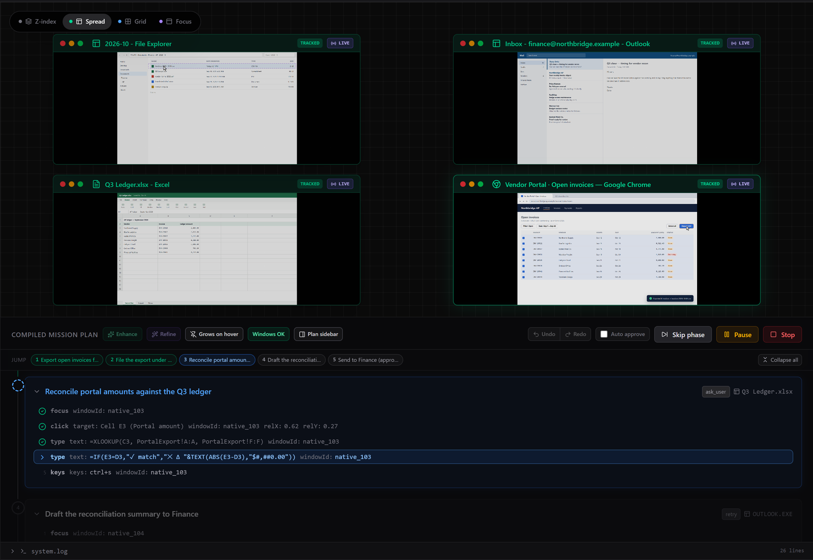

### 4 · It stops before anything you can't take back

Sending is consequential, so the plan carries an approval gate. Relay pauses with the draft on screen and waits. Approve and it finishes. Cancel and nothing was sent.

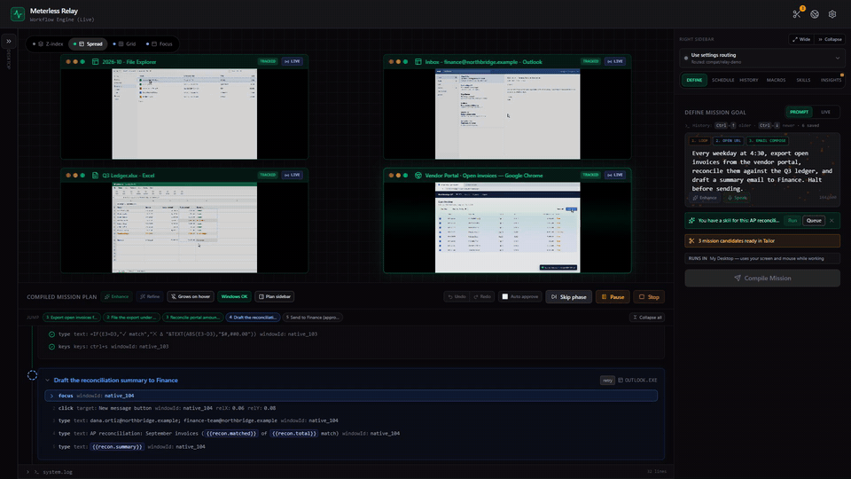

### 5 · Finished and checked

Every step gets a verdict. This run: **16 pass, 1 skipped, 17 verified steps.** A run that only looks finished never gets saved as a skill.


> The company and data in this run are made up, and the four app windows are stand-ins so nothing private is on screen. The Relay screens, the plan, and the run are the real app.

---

## What changed on screen

| | Before | After Relay |
|---|---|---|
| **Q3 Ledger** | 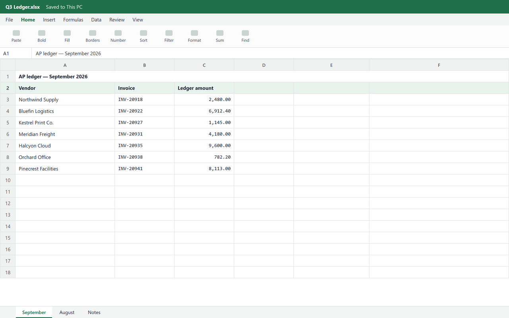 | 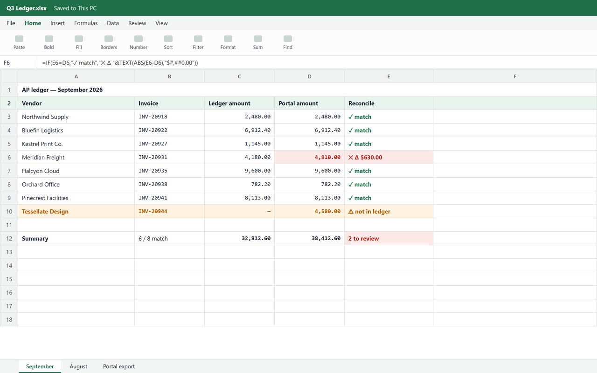 |
| **Vendor portal** | 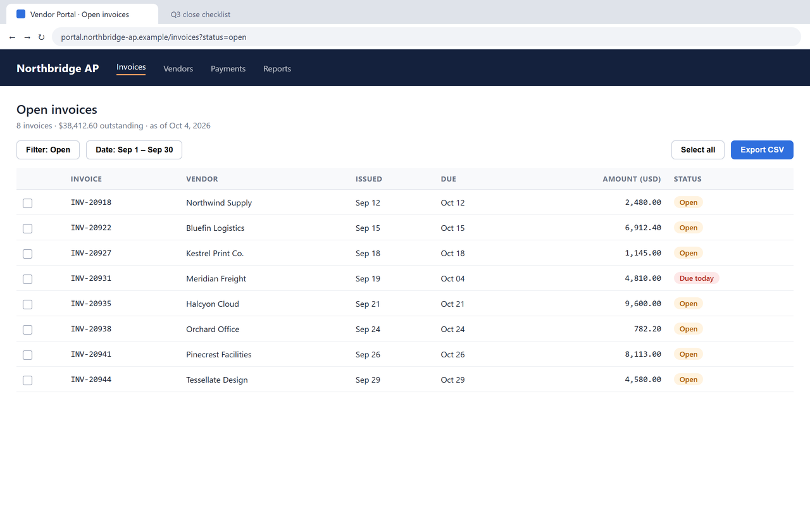 | 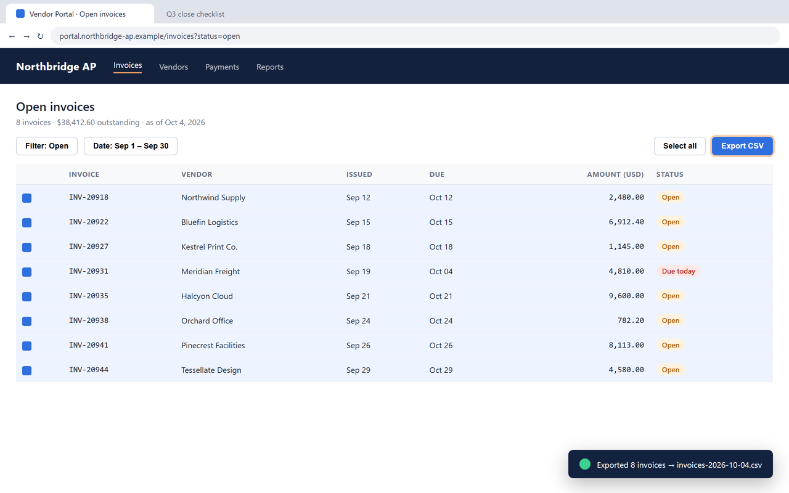 |
| **File Explorer** | 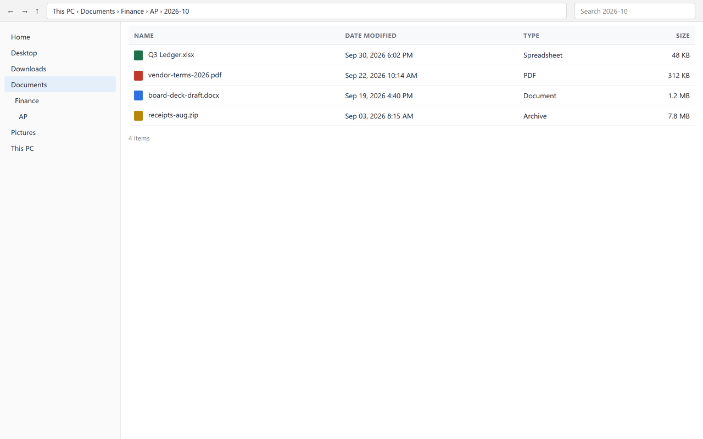 | 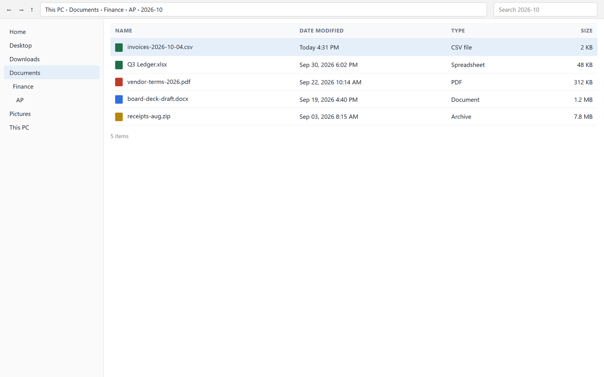 |
| **Mail** | 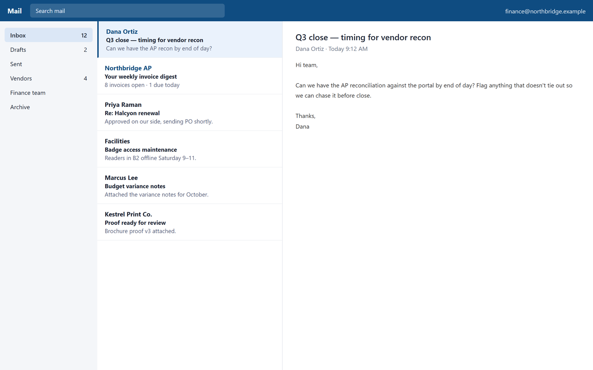 | 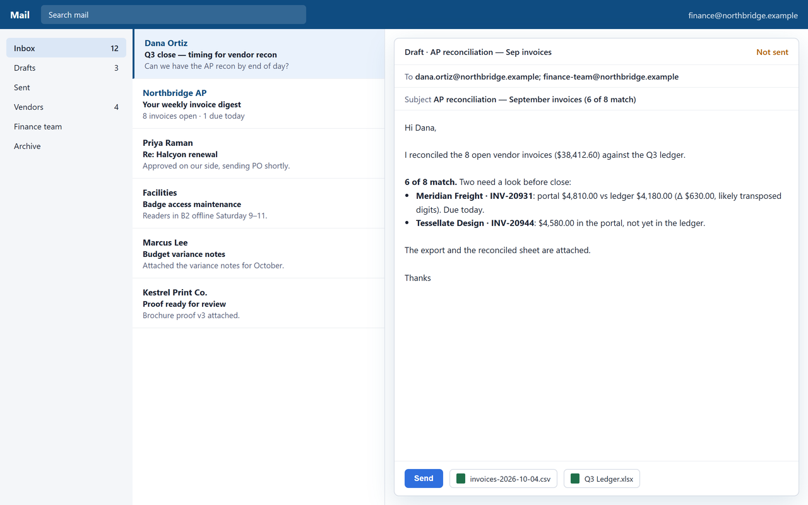 |

---

## The receipts

What came out the other end of that run.

**Reconciliation, September** · 8 invoices · $38,412.60

| Vendor | Invoice | Ledger | Portal | Result |
|---|---|--:|--:|---|
| Northwind Supply | INV-20918 | 2,480.00 | 2,480.00 | ✓ match |
| Bluefin Logistics | INV-20922 | 6,912.40 | 6,912.40 | ✓ match |
| Kestrel Print Co. | INV-20927 | 1,145.00 | 1,145.00 | ✓ match |
| **Meridian Freight** | **INV-20931** | **4,180.00** | **4,810.00** | **✕ off by $630.00** |
| Halcyon Cloud | INV-20935 | 9,600.00 | 9,600.00 | ✓ match |
| Orchard Office | INV-20938 | 782.20 | 782.20 | ✓ match |
| Pinecrest Facilities | INV-20941 | 8,113.00 | 8,113.00 | ✓ match |
| **Tessellate Design** | **INV-20944** | **missing** | **4,580.00** | **⚠ not in ledger** |

**The draft it left for you** (not sent):

> **Subject:** AP reconciliation: September invoices (6 of 8 match)
>
> I reconciled the 8 open vendor invoices ($38,412.60) against the Q3 ledger. 6 of 8 match. Two need a look before close:
> - **Meridian Freight, INV-20931:** portal $4,810.00 vs ledger $4,180.00 (off by $630.00, likely transposed digits). Due today.
> - **Tessellate Design, INV-20944:** $4,580.00 in the portal, not yet in the ledger.
>
> The export and the reconciled sheet are attached.

**Saved to the Data Vault**, ready for the next run, a watch, or another mission as `{{recon.summary}}`:

| Key | Value |
|---|---|
| `ap.open_total` | $38,412.60 |
| `ap.mismatches` | 2 (a watch fired and queued vendor follow-ups) |
| `recon.summary` | 6 of 8 match, 2 to review |

---

## Automate it once. It gets cheaper every run.

<table>
  <tr>
    <td width="33%" valign="top"><b>Skills</b><br/><br/>A verified run becomes a skill: a replayable version of the job with parameters you can change. Replays run deterministically and only call a model to repair a step that drifted. In the demo workspace, the AP skill ran 231 of 238 steps with no model call.</td>
    <td width="33%" valign="top"><b>Schedules and watches</b><br/><br/>Run any mission or skill weekdays at 4:30, weekly, or monthly. Relay checks the needed windows are ready, handles missed runs your way, and pauses a job after repeated failures. Watches fire when a captured value changes.</td>
    <td width="33%" valign="top"><b>Teach by doing</b><br/><br/>Live mode and the macro recorder capture what you do, anchored to the controls you touched rather than screen positions, and turn it into a mission you can edit.</td>
  </tr>
</table>

---

## Take the tour

Every screen below is the shipping app with demo data.

<table>
  <tr>
    <td colspan="2">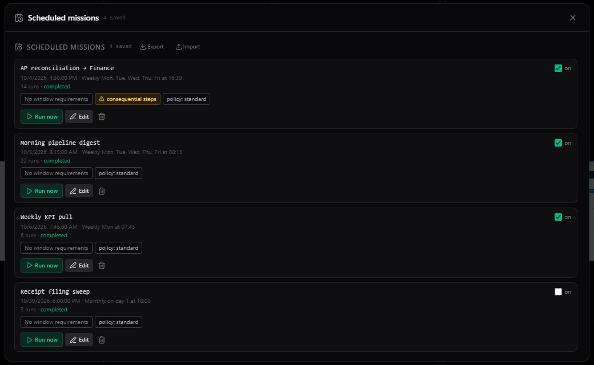<br/><b>Schedule.</b> Weekday, weekly, and monthly jobs with readiness checks, missed-run handling, and auto-pause after repeated failures.</td>
  </tr>
  <tr>
    <td colspan="2">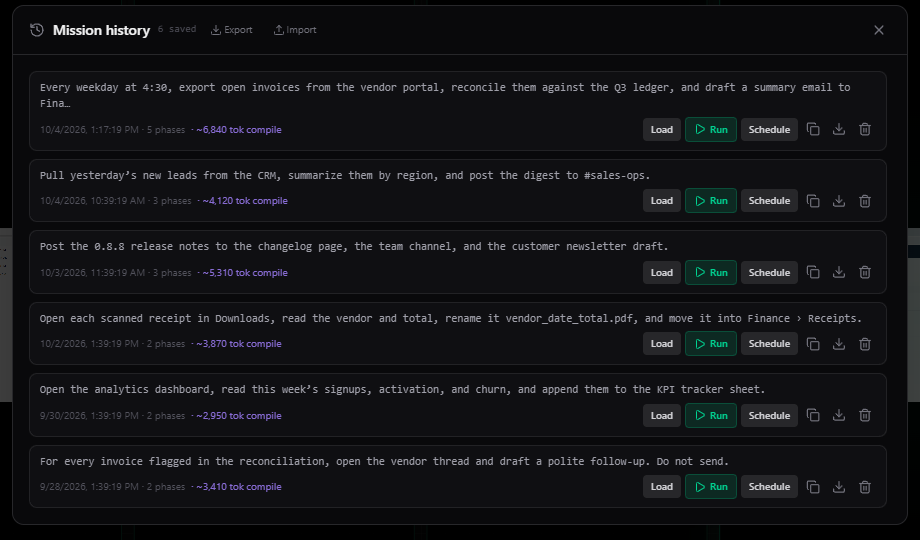<br/><b>History.</b> Load, run, schedule, clone, or export any mission Relay has written, with the compile cost on every row.</td>
  </tr>
  <tr>
    <td width="50%" valign="top">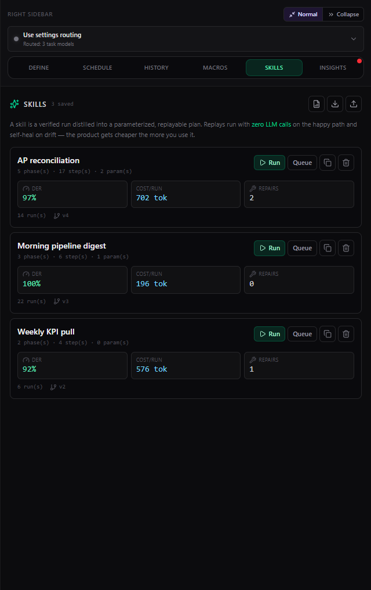<br/><b>Skills.</b> Versioned skills with run counts and how often each one runs without a model.</td>
    <td width="50%" valign="top">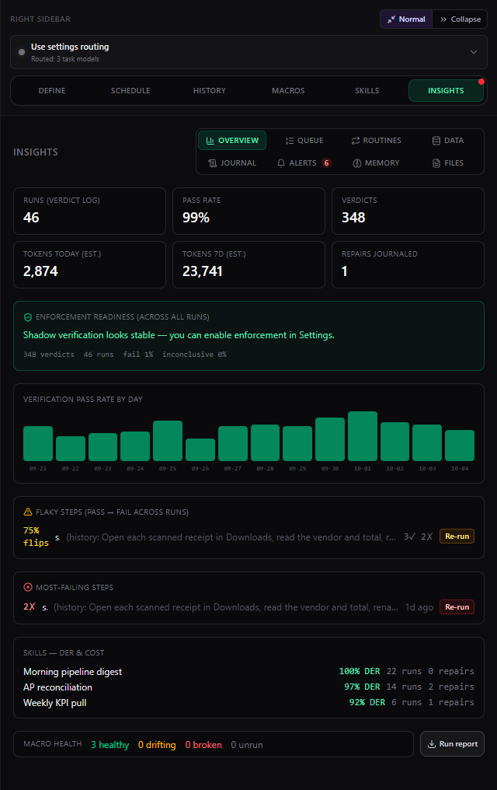<br/><b>Insights.</b> Pass rate by day, flaky and failing steps, token use, and enforcement readiness. All computed on your machine.</td>
  </tr>
  <tr>
    <td valign="top">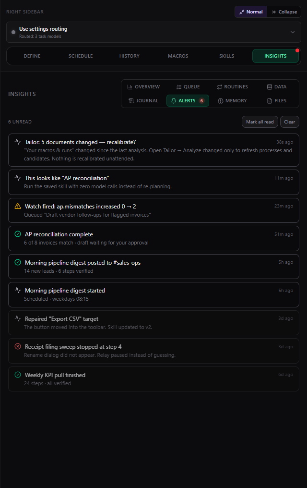<br/><b>Alerts.</b> Run results, schedule starts, watch triggers, applied repairs, and skill suggestions in one feed.</td>
    <td valign="top">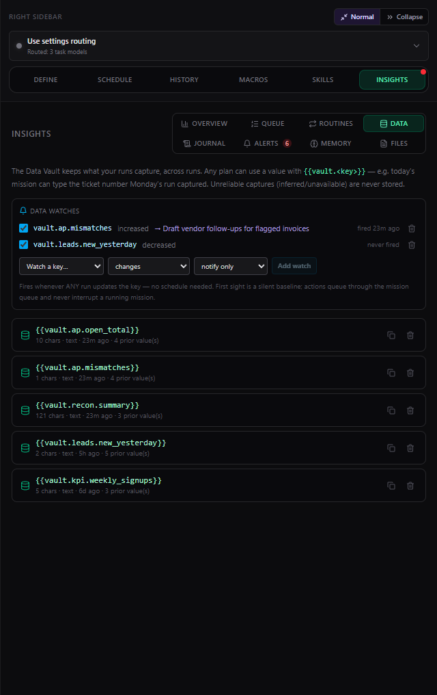<br/><b>Data Vault.</b> Every captured value with its history. Use one later as <code>{{vault.key}}</code> or watch it for changes.</td>
  </tr>
  <tr>
    <td valign="top">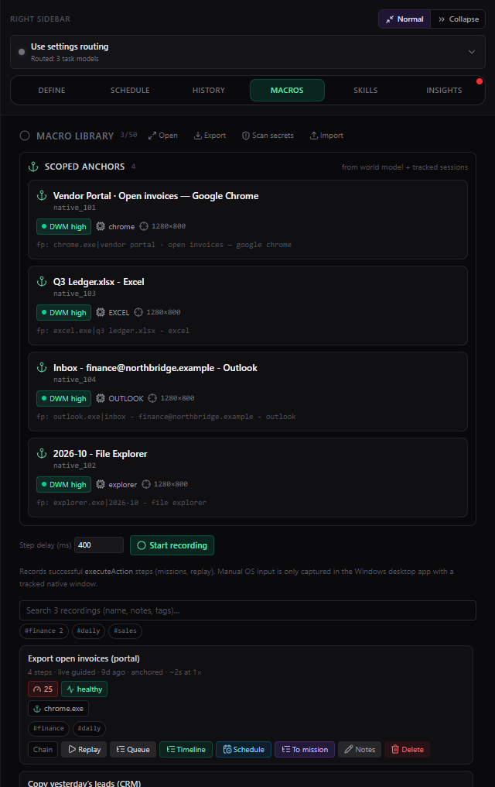<br/><b>Macros.</b> Recordings tied to the controls you used, with replay health, dry runs, and a timeline editor.</td>
    <td valign="top">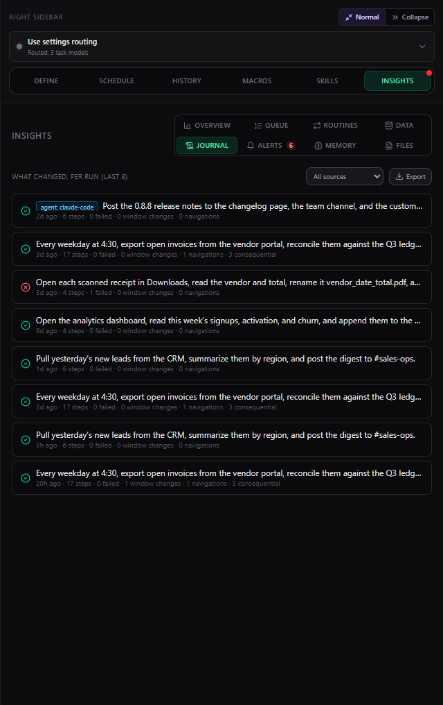<br/><b>Journal.</b> For every run: windows that opened, pages visited, characters typed, and which steps had real consequences.</td>
  </tr>
  <tr>
    <td valign="top">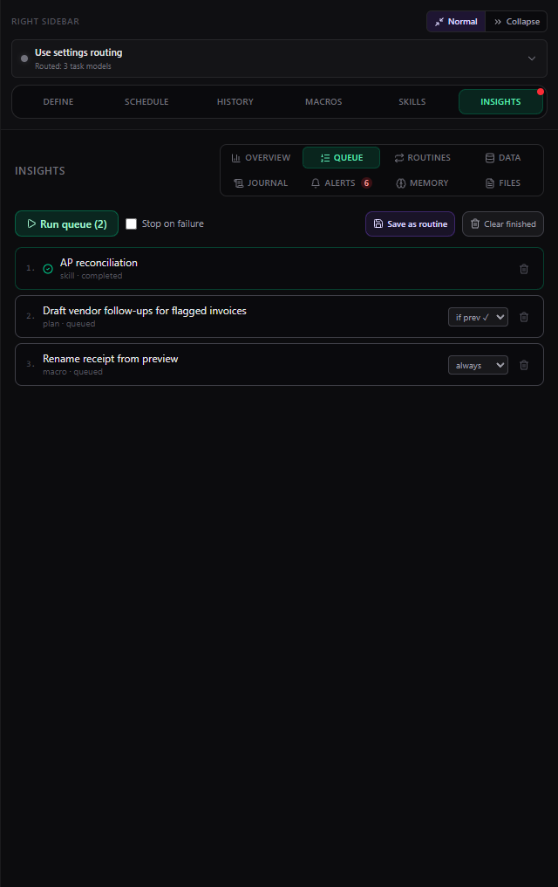<br/><b>Queue and routines.</b> Line up plans, macros, and skills with run-if conditions, or save them as a routine like Month-end close.</td>
    <td valign="top">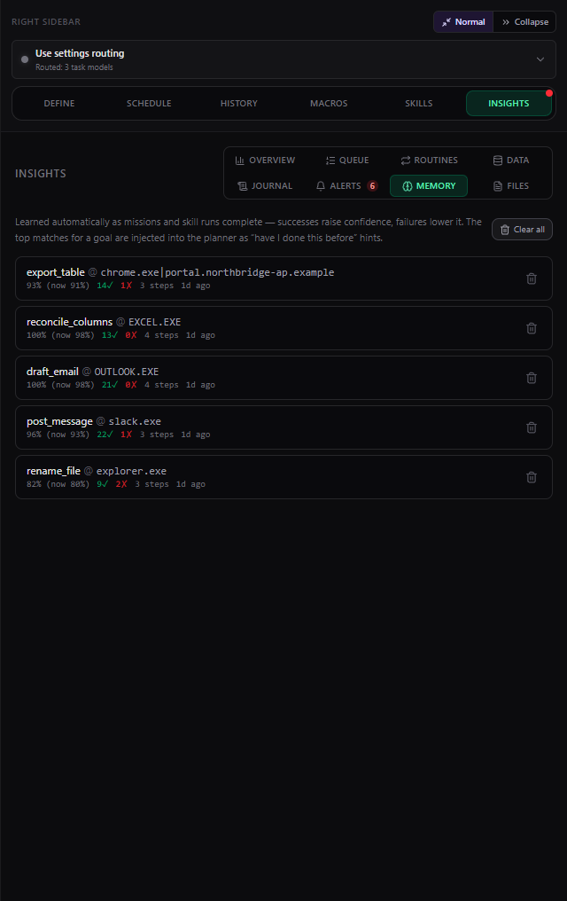<br/><b>Procedural memory.</b> The step patterns that work in each app, with success counts, fed back into the next plan.</td>
  </tr>
  <tr>
    <td colspan="2">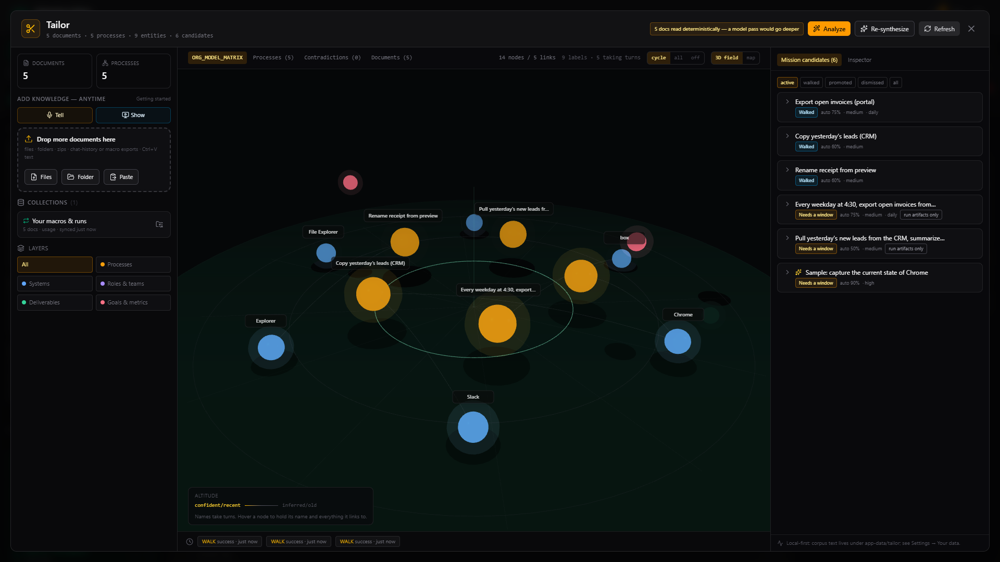<br/><b>Tailor.</b> Import process docs or your Claude and ChatGPT history. Tailor maps your systems and procedures and proposes missions that are ready to try.</td>
  </tr>
  <tr>
    <td valign="top">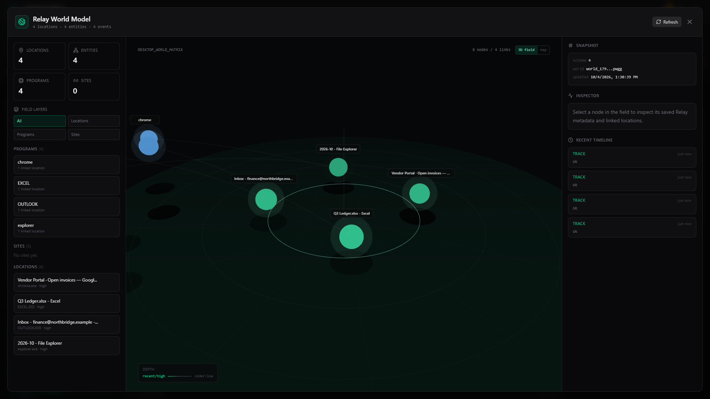<br/><b>World model.</b> What Relay remembers about your programs, sites, and windows, used to find the right target when titles and layouts change.</td>
    <td valign="top">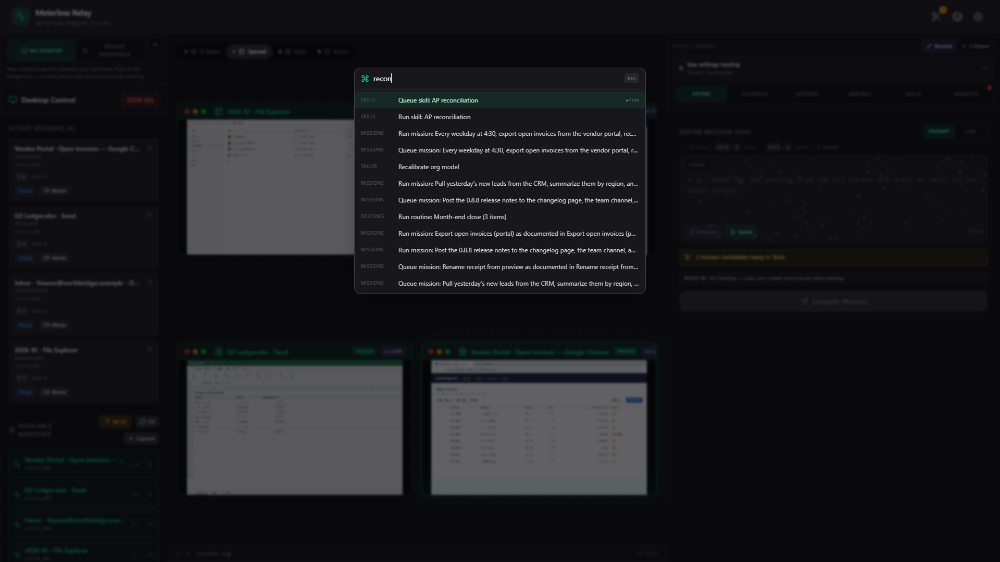<br/><b>Ctrl + K.</b> Jump to any mission, skill, macro, schedule, routine, or candidate from the keyboard.</td>
  </tr>
  <tr>
    <td valign="top">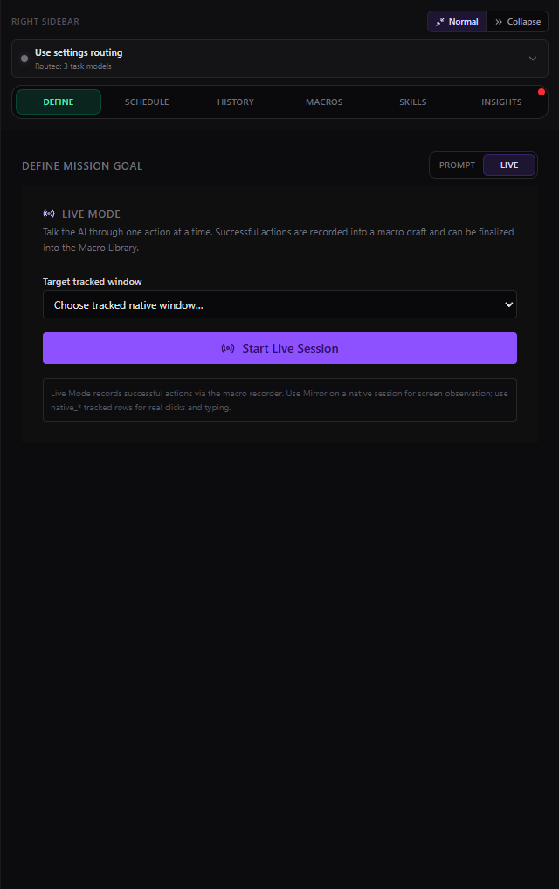<br/><b>Live mode.</b> Guide Relay in real time and let it draft the macro as you go.</td>
    <td valign="top"><br/><b>Model routing.</b> A model for planning, one for vision, one for reasoning, plus a single override when you want one model for everything.</td>
  </tr>
</table>

**Private Workspaces** run missions in a separate background browser with its own profile and files, so a job doesn't need your screen or mouse.

---

## Every step gets a verdict

Most automation tells you "done" or "error." Relay also tells you whether it actually checked.

| Verdict | What it means | What happens next |
|---|---|---|
| **verified** | A UI Automation check (or vision, when needed) confirmed the result: the export toast appeared, the cell changed, the draft exists. | The step counts toward a skill. |
| **failed** | The check ran and the screen was wrong. | Relay retries, skips, stops, or asks you, depending on the phase. |
| **unverifiable** | There was no way to check. | Relay says so. Under the default `standard` policy, a run can't become a skill until you review that step. |

In the run results these show up as **pass**, **fail**, **inconclusive**, and **skipped**, and **Export run report** saves the full record as JSON. Pop-up dialogs that appear mid-run (Save As, confirmations) are detected and handled before the run continues.

---

## Give your coding agent hands

The Agent Bridge lets Claude Code, Cursor, Codex, VS Code, or Gemini CLI drive Relay through a `relay` command and an MCP server. You decide what each agent is allowed to do, and steps with real consequences still wait for a person.

```bash
relay hello --agent claude-code --tier act      # asks you, inside Relay, to grant a tier
relay windows --pretty                          # window ids for --window
relay skill run "AP reconciliation" --param month=September
relay wait                                      # returns pending_approval at the gate
relay vault get recon.summary                   # read what the run captured
relay mcp-config --client claude                # MCP config snippet for your agent
```

The CLI isn't a separate download yet; for now it installs from the Relay source tree (see the docs). Run `relay help` for everything else: `find`, `click`, `type`, `keys`, `read`, `screenshot`, `plan`, `status`, `runs`, `artifacts`, `events --follow`, `doctor`. Setup is in [docs/agent-bridge.md](docs/agent-bridge.md).

---

## Your keys, your desktop

Pick a different model for planning, vision, and reasoning, or run small jobs on a local model in your browser.

| Provider | Good for |
|---|---|
| Google Gemini | Planning, vision, web research |
| Anthropic Claude | Reasoning and planning |
| OpenAI GPT | Any task |
| OpenRouter | Many vendors behind one key |
| OpenCode Go | Open models |
| Local (WebGPU) | Offline, small text jobs |
| Meterless Runtime | Your own machine, routing modes |
| Any OpenAI-compatible endpoint | LAN servers and gateways |

**Privacy.** Relay doesn't stream your desktop anywhere. When a model needs to think, your goal plus a text summary of your open windows (titles, apps, sizes) and what Relay has learned about them go to the provider you picked. Screenshots go out only for vision steps. Your missions, recordings, history, captured data, and files stay in `%APPDATA%\com.meterless.relay`, and you can back them up, export them, or delete them from **Settings → Data & Alerts**. Details in [docs/privacy.md](docs/privacy.md).

---

## Get Relay

1. **Download** [`meterless-relay-latest.exe`](https://meterless.ai/Installers/meterless-relay-latest.exe) (3.3 MB, Windows 10 and 11). Updates arrive in the app.
2. **Add a model** in **Settings → API Keys**, or point Relay at a local or OpenAI-compatible endpoint.
3. **Track a window or two** under **Available Windows → Track**.
4. **Describe the job** in the Define tab and press **Compile Mission**. Read the plan, then press **Start**.

The [getting started guide](docs/getting-started.md) goes from a fresh install to a scheduled, verified mission in about five minutes. More examples of goals that work well are in [examples/](examples/README.md).

### Shipping every couple of weeks

| Version | Date | Highlights |
|---|---|---|
| **0.8.8** | Sep 26 | Agent bridge, Tailor, environment runtime |
| 0.8.7 | Sep 10 | Live countdown on every wait, with Continue now |
| 0.8.6 | Sep 8 | Private Workspaces recover on their own mid-run |
| 0.8.5 | Sep 3 | Tailor imports Claude and ChatGPT history |
| 0.7.12 | Jul 31 | Fixes |
| 0.7.11 | Jul 27 | Signed in-app updates |

Full notes in [CHANGELOG.md](CHANGELOG.md).

---

## How Relay fits with Meterless

```text
Gaia remembers.   Swarms thinks in parallel.   Relay does the work on your desktop.
```

Relay is one of the apps built on the [Meterless](https://github.com/meterless/meterless) local-first stack. [Gaia](https://github.com/meterless/gaia) keeps your projects and memory. [Swarms](https://github.com/meterless/swarms) runs teams of agents in parallel.

---

## Questions

**Do I need to code?** No. If you can describe the job in an email, you can run it.

**Is this macro recording with AI on top?** Recording is one way in. The core is a planner, an engine that drives real windows, a check on every step, approval gates, and skills built from verified runs.

**Can it do something I didn't approve?** You see the plan before it runs, and phases that send, submit, delete, or pay carry approval gates. Agents connected through the bridge can't approve those for you.

**Mac or Linux?** Not yet. The part that controls windows is Windows-only today.

More in [docs/faq.md](docs/faq.md) and [docs/troubleshooting.md](docs/troubleshooting.md). Found a security issue? See [SECURITY.md](SECURITY.md).

---

## License

Relay is released under the [Meterless Permissive Use License](LICENSE). You can use, copy, modify, and publish it for personal, internal, commercial, research, or production work. You can't resell or redistribute it as a standalone product or competing offering.
