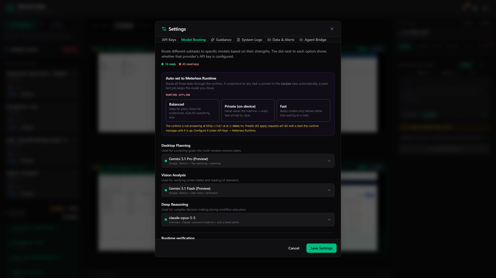
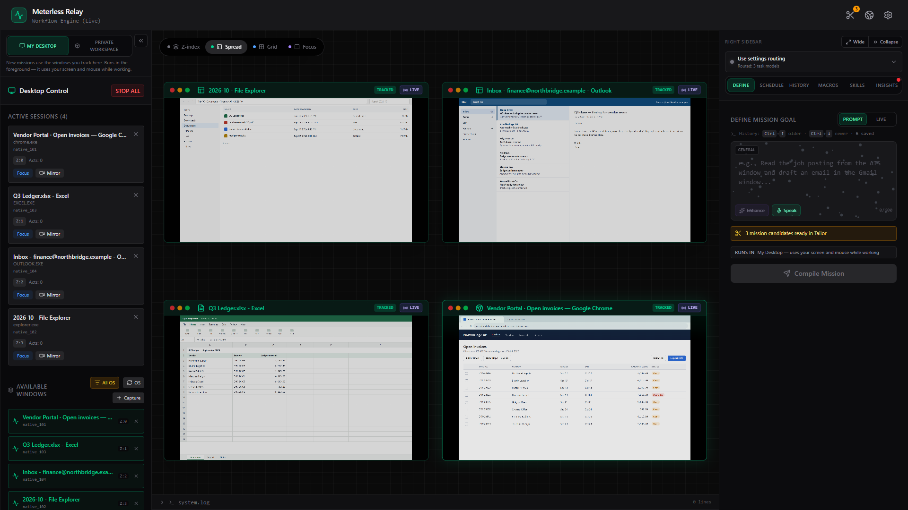
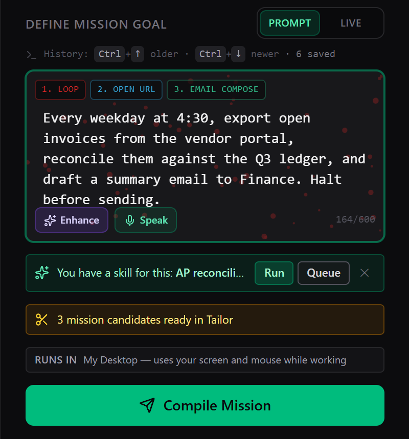
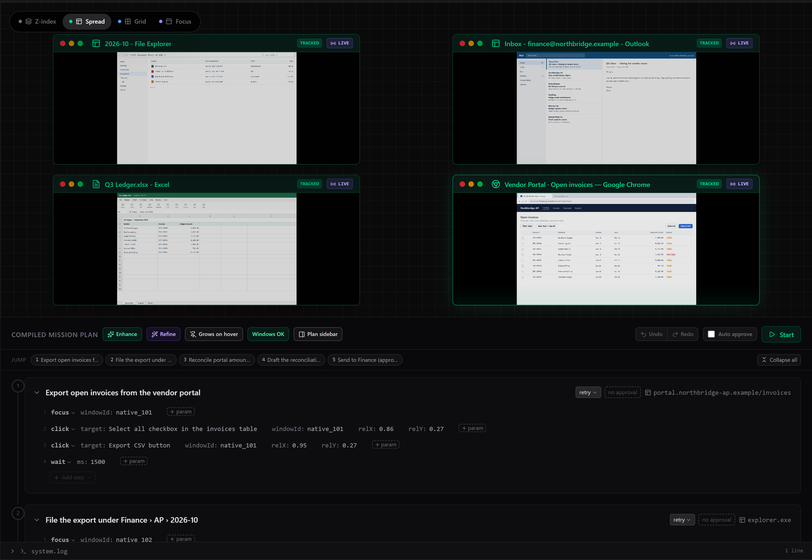
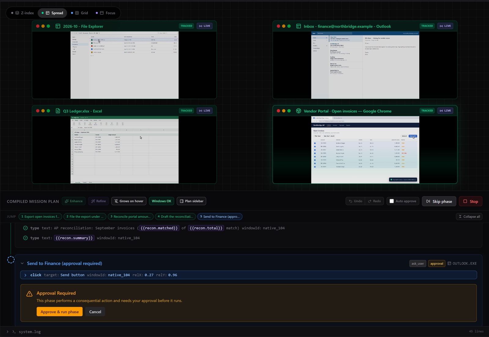
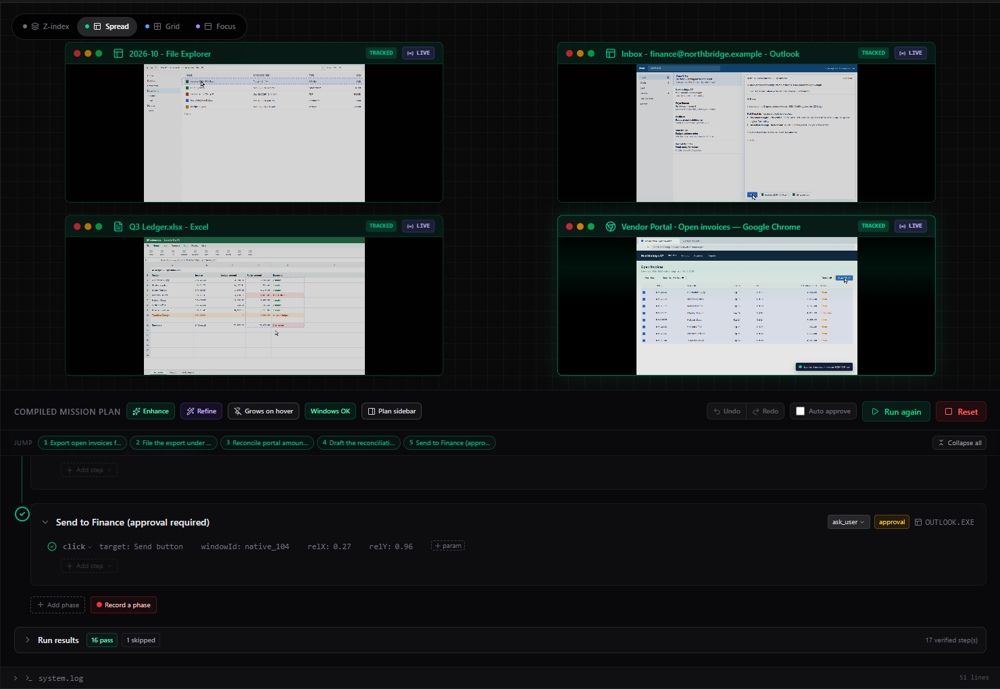

# Getting started

This guide takes you from a fresh install to a verified mission you can run again, schedule, or save as a skill. It takes about five minutes.

## 1. Install Relay

Download [`meterless-relay-latest.exe`](https://meterless.ai/Installers/meterless-relay-latest.exe). It's 3.3 MB and runs on Windows 10 and 11. Run the installer and click through. Relay installs for your Windows user and shows up in the Start menu as **Meterless Relay**.

**If Windows SmartScreen warns about an unrecognized app,** click **More info**, then **Run anyway**. The installer doesn't carry a Windows code-signing certificate yet, so SmartScreen flags it. In-app updates are a separate matter: Relay checks each update's signature before installing it (see [step 9](#9-staying-up-to-date)).

The first time Relay opens, it plays a short intro. Click anywhere, or press **Skip intro**, to go straight in. Small guidance tips then point at the next useful thing to do. You can turn them down or off under **Settings → Guidance**.

## 2. Add a model

Relay uses an AI model to plan. You bring the key, and model calls go straight from your machine to the provider you choose.

1. Click the **gear icon** at the top right to open **Settings**.
2. On the **API Keys** tab, paste a key for one or more providers:
   - **Google (Gemini)**
   - **Anthropic (Claude)**
   - **OpenAI (GPT)**
   - **OpenCode Go (Open models)**
   - **OpenRouter (Multi-vendor)**

   Each one has a **Get Key** link to the provider's key page.
3. Click **Verify** next to the key. You should see **Verified**.
4. Click **Save Settings**.

You can also skip hosted keys entirely. These options live on the same tab:

- **Meterless Runtime:** a local-first router on this PC or another machine on your network.
- **OpenAI-compatible endpoint:** vLLM, LM Studio, llama.cpp, LiteLLM, a company gateway, and so on.
- **Local WebGPU models:** small Qwen models that run inside Relay, for light text tasks. You pick them in the routing pickers.

Next, open the **Model Routing** tab to choose which model handles each job:

- **Desktop Planning** compiles goals into mission plans.
- **Vision Analysis** checks screen states and reads UI.
- **Deep Reasoning** handles harder decisions mid-run.

The dot next to each model shows whether its provider has a key. To swap models for a while without changing these settings, use the routing picker at the top of the right sidebar. It reads **Use settings routing** by default.

## 3. Track the windows you want Relay to use

This is the step people skip, and then wonder why the plan looks wrong. Relay plans around the windows you track, so take thirty seconds here.

1. Open the apps you want to automate: a browser, Excel, Outlook, File Explorer, whatever the job uses.
2. In the **Desktop Control** panel, make sure the **My Desktop** tab is selected.
3. Under **Available Windows**, click **OS** to refresh the list from Windows. To see every window instead of just the ones you've picked, switch the filter from **Focused** to **All OS**.
4. Click each window you want so it's highlighted, then click **Track (N)**.
5. If you tracked a single window, Windows' screen-share picker opens next. Pick **the same window** to give it a live preview (Relay calls this **Mirror**). You can also add a Mirror later from the window's card.

Tracked windows appear under **Active Sessions**. Each card has **Focus**, **Mirror** and an **X** to stop tracking. The center preview shows them, and the pills at its top switch the layout: **Z-index**, **Spread**, **Grid** or **Focus**.

**STOP ALL**, at the top of the panel, stops every session at once.

## 4. Describe the job

Open the **Define** tab in the right sidebar and keep it on **Prompt**. Type what you want done, the way you'd explain it to a coworker. Name the windows and say where the result should go.

> *Open the Q3 Ledger in Excel, read every vendor and amount in column B, and draft an email in Outlook to finance@example.com summarizing anything over $5,000. Don't send it.*

Some tools around the goal box:

- **Enhance** rewrites a rough draft into a concrete instruction. **Undo** puts your draft back.
- **Speak** dictates into the box.
- **Ctrl+↑ / Ctrl+↓** step back and forth through goals you've typed before.
- If you already have a saved skill for the job, a **You have a skill for this** chip appears. Its **Run** button replays the skill without compiling anything.
- The **Runs in** line tells you where the mission will run: on **My Desktop**, or in a **Private Workspace**.

Press **Enter** or click **Compile Mission**. Relay snapshots your desktop, runs a short research pass, and writes a structured plan. Nothing on your screen moves yet.

## 5. Read the plan before you run it

The plan opens in the **Compiled Mission Plan** panel, under the desktop preview. It's split into phases, and each phase holds numbered steps aimed at your tracked windows. Every step lists its action, its target, and what Relay will check afterwards.

What you can do here:

- **Edit any step inline.** Click a value to change it. **Undo** and **Redo** step through your edits.
- **Enhance** reviews the whole plan against your original goal and shows the proposed improvements before you accept them.
- **Refine** lets you highlight particular phases or steps and describe what should change. Only those parts are rewritten.
- **Fix windows** appears when a step points at a window you haven't tracked. **Windows OK** means everything lines up.
- **Plan sidebar** and **Dock below** move the plan beside or under the preview.
- **Auto approve** skips approval gates while it's ticked. Leave it off until you trust the workflow.

## 6. Run it

Click **Start**. Relay types, clicks and switches windows for you, so keep your hands off the mouse and keyboard while it works.

- The step that's running is highlighted. When Relay is waiting on something, a countdown shows how long it will wait. **Continue now** skips the wait.
- **Pause** / **Resume** and **Skip phase** are there throughout the run. **Stop** ends it. There's no keyboard shortcut for stopping, so use the button, or **STOP ALL** in Desktop Control.

### Approval gates

Phases that do something you can't take back, like sending, submitting, deleting or paying, stop and show **Approval Required**. Look at the screen, then click **Approve & run phase**, or **Cancel** to end the mission there.

### If a step fails or a dialog appears

- **A failed step** gives you **Retry step**, **Skip step** and **Skip phase**. You can edit the step before you retry it.
- **An unexpected dialog** (Save As, "unsaved changes", a confirmation) is usually handled for you: Relay reads the dialog and completes it or closes it. If it can't decide safely, it pauses with **A dialog is in the way**. Deal with the dialog yourself, then click **Retry step**. You choose how this works under **Settings → Model Routing → Modal dialog handling**.

## 7. Check the results

When the run ends, **Run results** appears below the plan. Each step got a verdict: **pass**, **fail**, **inconclusive** (no check was possible) or **skipped**. Click a step to see what was checked.

- **Explain this failure** gives a short summary of what went wrong, put together on your machine with no model call. **AI explanation** sends that summary, not your raw logs, to your model for a plain-English explanation.
- **Export run report** saves the run as JSON.
- **Run again** starts a fresh run of the plan, including any edits you made. **Reset** clears the run.

Verification starts in **Shadow** mode. Relay records the checks but never fails a run because of them. Once you've collected enough clean runs, **Settings → Model Routing → Runtime verification** offers **Promote to Enforce**.

## 8. Keep it, schedule it, make it a skill

- **History tab.** Every compiled mission is saved here. You can **Load** it, run it, **Schedule** it, duplicate it, or export it as JSON.
- **Schedule tab.** Run a mission once, daily, weekly (pick the days) or monthly. Before each run, Relay checks that the windows it needs are open. Optional settings decide what happens to a run missed while Relay was closed, and pause the schedule after a number of failures in a row. Schedules only run while Relay is open.
- **Skills tab.** After a successful run, a **Last run completed** card offers **Save as skill**. A skill replays the verified steps with zero model calls when nothing has changed. If something has moved, it repairs itself and asks before keeping the fix. Next time you type a similar goal, Define offers the skill instead of compiling again.

## 9. Staying up to date

Relay checks for a newer build when it launches, at most once a day. When there's one, a banner offers **Update now**, **Later** or **Don't show again**. **Update now** downloads the signed update, checks its signature, installs it and restarts Relay. Nothing installs unless you click.

To check by hand, or to see which version you're on, go to **Settings → Data & Alerts → App updates**.

---

## Where to go next

- [features.md](features.md): everything Relay can do, organized by what you're trying to get done.
- [shortcuts.md](shortcuts.md): the keyboard shortcuts that really exist.
- [agent-bridge.md](agent-bridge.md): let Claude Code, Codex, Cursor or another agent drive Relay.
- [troubleshooting.md](troubleshooting.md): fixes for common problems.
